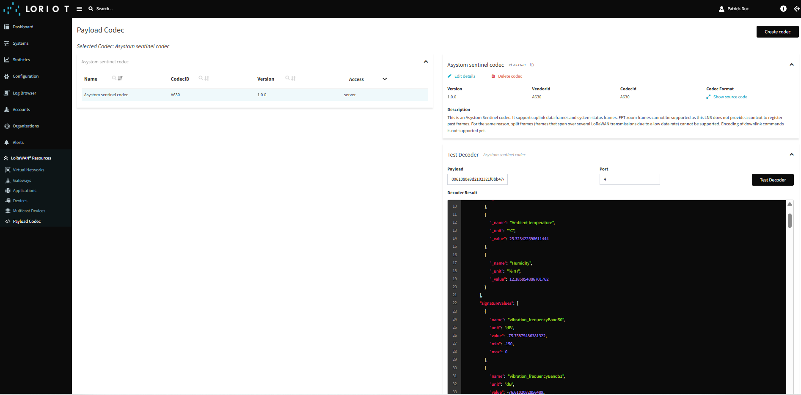

# Asystom LoRaWAN Codec

This repository provides a basic LoRaWAN codec for Asystom Sentinel devices. It complies with the LoRaWAN Codec API Specification version 1.0.0.
It has been successfully tested on both Loriot and Actility LNS environments.

## Functionalities

This codec supports uplink data frames and system status frames (frames that are issued by a Sentinel device at startup time and that contain a description of the device configuration).

FFT zoom frames cannot be supported as a standard LNS does not provide a context to register past frames, which are necessary to decode FFT zoom frames. For the same reason, split frames (frames that span over several LoRaWAN transmissions due to a low data rate) cannot be supported.

However, the codec includes some functions to handle split frames, as some LNS environments provide proprietary extensions allowing to memorize data between subsequent calls to codec functions. This feature may be used in the future to provide support for split frames as well as FFT zoom frames.

Encoding of downlink commands is not supported yet but will be in the future.

## Learn More

The "doc" subdirectory contains two documents that describe the format of Sentinel frames.
It also includes a subdirectory "jsdoc" that provides some basic information on the codec interface.

You can learn more on the LoRaWAN Codec API Specification at this address : [LoRaWAN Codec API Specification 1.0.0](https://resources.lora-alliance.org/technical-specifications/ts013-1-0-0-payload-codec-api)
